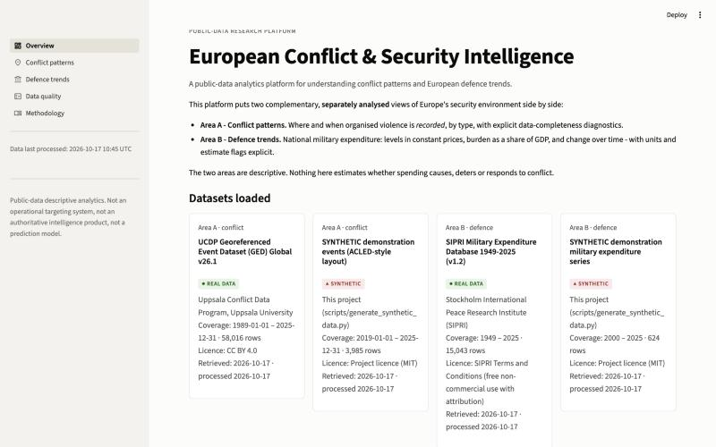
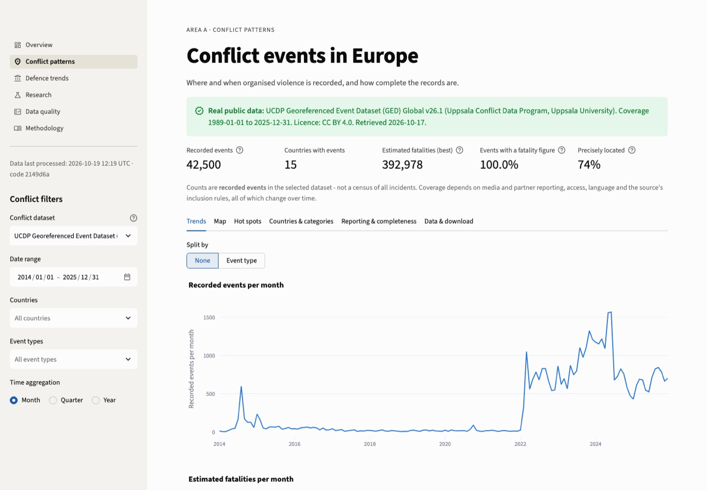
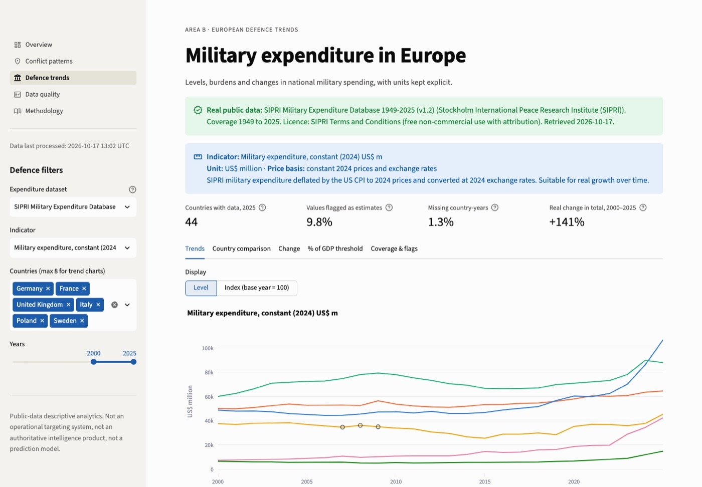
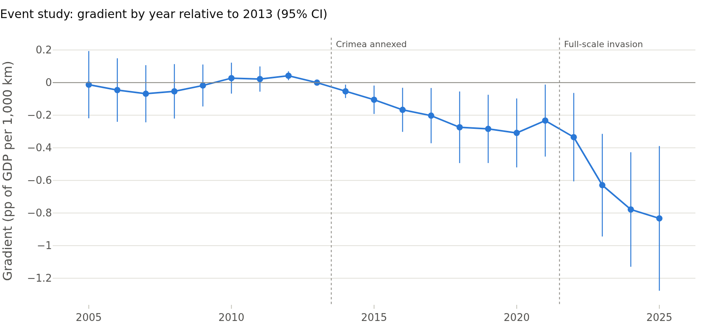

# European Conflict & Security Intelligence

**A public-data analytics platform for understanding conflict patterns and European defence trends.**

**Live demo:** <https://european-conflict-security-intelligence-qrkpqqct8esruqgjjjhcyr.streamlit.app> · 

A reproducible Python, SQL and geospatial pipeline with a Streamlit dashboard. It puts two
separately analysed views of Europe's security environment side by side:

- **Area A: Conflict patterns.** Organised violence *recorded* in the UCDP Georeferenced Event
  Dataset (58,016 European events, 1989–2025): trends, event types, geography, fatality estimates
  with uncertainty ranges, and diagnostics of how complete the record is.
- **Area B: European defence trends.** SIPRI military expenditure for 44 European countries
  (1949–2025): constant-price levels, % of GDP, change over time, with units, price bases and
  SIPRI's estimate flags kept explicit.

- **Research extension: proximity and military burden.** A pre-specified two-way fixed-effects
  event study testing whether European countries closer to Russia raised military spending (% of
  GDP) more after 2014 and 2022, with wild cluster bootstrap inference and seven robustness checks.

It is designed around one rule: **every number shown is traceable to a licensed source file, a
documented transformation, and a stated denominator.**



| Conflict patterns (UCDP GED, 2014–2025) | Defence trends (SIPRI, constant 2024 US$) |
|---|---|
|  |  |

---

## Quick start

Requires Python 3.12 (tested on macOS).

```bash
python3.12 -m venv .venv
source .venv/bin/activate
pip install -r requirements.txt
streamlit run app.py
```

On first launch the app builds its database from what ships with the repository: the
**validated European UCDP subset** in `data/public/` (CC BY 4.0 permits redistribution), and the
**synthetic demo data**, clearly labelled. It also downloads the **SIPRI workbook (~1 MB)** from
sipri.org, because SIPRI's terms do not allow committing it. Set `ECSI_AUTO_FETCH=0` to skip the
download. To rebuild everything from the original raw files (~41 MB, no account needed):

```bash
python -m src.pipeline fetch    # UCDP GED 26.1, SIPRI Milex 2025 v1.2, Natural Earth borders
python -m src.pipeline build    # validate -> data/processed/security.duckdb + quality reports
python -m src.pipeline report   # regenerate reports/RESEARCH_BRIEF.md and figures
streamlit run app.py
```

`python -m src.pipeline all` runs fetch, build and report in one go. ACLED (account required) is
covered in [docs/DATA_ACQUISITION.md](docs/DATA_ACQUISITION.md).

### Tests

```bash
pytest
```

62 tests: validation primitives, each source adapter, aggregation logic, SQL-versus-pandas
consistency, SQL injection safety, synthetic-defect detection, the mocked ACLED API client, and a
headless render of every dashboard page, and for the research module: agreement with statsmodels,
recovery of a known effect, bootstrap size under the null, and the Crimea geometry. Without the Natural Earth file, the boundary-dependent
test is skipped. GitHub Actions runs the suite on every push (`.github/workflows/tests.yml`).

### Deploying (Streamlit Community Cloud)

1. Push the repository to GitHub.
2. On <https://share.streamlit.io>, choose **Create app** → this repository, branch `main`,
   file `app.py`, and **Python 3.12** under *Advanced settings*.
3. The first visit builds the database (UCDP from `data/public/`, SIPRI downloaded once).
4. After a push that changes `requirements.txt` or modules under `src/`, use **Manage app → ⋮ →
   Reboot app** if the change does not show. Streamlit Cloud reloads the entry script but can keep
   already-imported modules in memory. On restart, the app compares the database's schema version
   and rebuilds it if it is out of date.

---

## What the dashboard contains

| Page | Content |
|---|---|
| **Overview** | Project framing; dataset cards (source, coverage, licence, retrieval date, REAL/SYNTHETIC tag); a side-by-side country view with **two separate charts** (recorded events; % of GDP); responsible-use statement |
| **Conflict patterns** | Filters for dataset, dates, countries, event types and aggregation. KPIs, each with its denominator. Tabs: trends (events; fatalities with low–high band) · map (points/density, precise-only toggle, point-in-country rate, grid concentration, annual mean centre and standard distance) · countries & categories (incl. equal-length period comparison with a minimum-base rule) · reporting & completeness · download (licence permitting) |
| **Defence trends** | Indicator selector with unit, price basis and definition always displayed. Trends (level or index base-year = 100), country comparison (estimates hatched), change (percent for constant prices, percentage points for shares; refused for current prices), ≥ X% of GDP counts with denominators, coverage and flags |
| **Research** | Pre-specified event study on proximity to Russia: raw scatter, main estimates with wild-bootstrap p-values, event-study chart with pre-trend test, robustness table, leave-one-out and placebo, and a plain statement of what is and is not identified |
| **Data quality** | Every validation check per dataset, with status, affected rows, action taken; provenance (URL, SHA-256, retrieval time); transformations; column missingness; JSON report download |
| **Methodology** | Renders [docs/METHODOLOGY.md](docs/METHODOLOGY.md): definitions, denominators, caveats |

## Research output

[`reports/RESEARCH_BRIEF.md`](reports/RESEARCH_BRIEF.md) is generated from the database, so every
number in it is computed rather than typed. Its commentary is pinned to the SHA-256 of the input
files, and the brief prints a warning when the data change. Examples of what the analysis surfaced:

- Since 2022, 96% of UCDP's European events are located in Ukraine. Any "Europe" aggregate for the
  period is effectively a Ukraine aggregate.
- The 2025 fall in recorded events (−32%) comes with flat fatality estimates, a collapse in
  date-uncertain records (18% → 2.6%) and fewer sources per event. It is evidence of a coding
  change, **not** of de-escalation.
- 1.2k events fall outside their stated country's present-day border. Almost all are UCDP's
  historical coding ("Serbia (Yugoslavia)", "Russia (Soviet Union)"), found by a GeoPandas
  point-in-polygon check.
- European real military expenditure (balanced panel of 41 countries) rose 113% between 2014 and
  2025, or 86% excluding Russia and Ukraine. Countries at or above 2% of GDP went from 7 to 27
  of 44.

### Research finding (pre-specified design, [docs/RESEARCH_DESIGN.md](docs/RESEARCH_DESIGN.md))

Among 37 European countries (2005–2025), the **post-2022 rise in military burden is steeper the
closer a country is to Russia**: an additional −0.44 pp of GDP per 1,000 km farther away (wild
cluster bootstrap p < 0.001). The result holds in all seven robustness checks and when any single
country is dropped. The post-2014 gradient (−0.19 pp) is weaker. It vanishes when the South Caucasus
is included, and the pre-trend test rejects at 5%. The brief reports this rather than hiding it.
The design describes a gradient in budgets, not a causal effect of distance.



## Architecture

```
app.py                      Streamlit entry point (st.navigation, 5 pages)
src/
  config.py                 paths + source registry (URLs, licences, citations, export rules)
  pipeline.py               CLI: fetch | build | report | all
  report.py                 research brief + figures (computed from the DB)
  research.py               runs the pre-specified proximity analysis (used by app + report)
  data/
    fetch.py                documented downloads, provenance sidecars, ACLED OAuth client
    ucdp.py · acled.py · sipri.py    source adapters -> canonical schemas
    events.py               shared event validation/enrichment
    validation.py           checks + machine-readable QualityReport
    boundaries.py           Natural Earth point-in-country check (GeoPandas, EPSG:3035)
    countries.py            explicit name -> ISO3 harmonisation
    exposure.py             capital-to-Russia / war-event distances (Crimea removed), NATO coding
    worldbank.py            World Bank WDI API client (GDP per capita)
    schema.py               canonical schemas + indicator catalogue (units, denominators)
  database/
    db.py                   atomic DuckDB build (events, milex, datasets, quality_checks)
    queries.py              parameterised SQL, one source per query
  analysis/
    conflict.py             temporal/country/category aggregation, completeness, comparisons
    spatial.py              grid counts, concentration, mean centre, standard distance
    defence.py              growth, change, index, balanced totals, thresholds (unit-guarded)
    quality.py              missingness diagnostics
    proximity.py            panel, TWFE OLS, CR1 cluster SEs, wild cluster bootstrap, event study
  visualization/
    theme.py · charts.py    Plotly template, CVD-checked palette, synthetic watermark
  ui/                       one module per page + shared helpers
scripts/generate_synthetic_data.py   seeded demo data with deliberately injected defects
data/sample/                SYNTHETIC demo CSVs (committed)
data/public/                committed open data: UCDP Europe subset, exposure distances, WDI GDP pc
data/reference/             hand-coded NATO accession table (with source)
data/raw/ data/processed/   git-ignored (licences + size)
reports/                    RESEARCH_BRIEF.md, figures/, data_quality/*.json
docs/                       methodology, sources & licences, acquisition, data dictionary
tests/                      pytest suite
```

**Flow:** `fetch` → raw files + provenance → adapters (validate, harmonise, flag) → canonical
tables → DuckDB → parameterised SQL → pure-pandas analysis functions → Plotly → Streamlit.
Analysis functions contain no UI code and are unit-tested in isolation.

## Analytical safeguards built into the code

| Risk | Safeguard |
|---|---|
| Duplicate events / double counting | De-duplication by id (reported); possible duplicates flagged, not dropped; tests check category splits sum to the total |
| Inconsistent date formats | Explicit format list (ISO → "05 March 2023" → day-first); US month-first never guessed; every non-ISO parse counted |
| Missing / invalid coordinates | Nulled and excluded from maps, never from counts; point-in-country plausibility test |
| Missing values read as zero | Nullable dtypes throughout; `sum(min_count=1)`; every total carries its coverage |
| Incompatible units / price bases | One indicator per frame enforced; growth refused on current prices; ratios change in pp; ratios never summed |
| Changing country coverage in totals | Balanced-panel totals, with included/excluded countries reported |
| Unstable percentages | % change only with base ≥ 10 events; equal-length windows enforced |
| Mixing datasets | Every query and analysis restricted to one source |
| Synthetic mistaken for real | Separate source keys, label validation on load, red banner, chart watermark, separate demo brief |
| Causal over-reach | Side-by-side view uses separate axes and an explicit caveat; no correlation or regression is presented |

## Responsible Use and Data Limitations

This is a **public-data research and descriptive analytics project**. It is **not** an
operational targeting system, **not** an authoritative intelligence product, and **not** a
reliable conflict prediction model.

- **Recorded is not occurred.** Event datasets depend on media, NGO and partner reporting. Access,
  attention, language and the fog of war shape what is recorded. Counts are lower bounds of
  *reported* activity, and coverage changes over time.
- **Inclusion rules differ.** UCDP includes only conflicts above 25 battle-related deaths per year.
  ACLED includes non-lethal events. Their counts are not comparable and are never combined.
- **Fatalities are estimates** (UCDP best/low/high) or conservative reports (ACLED), and are
  contested in active wars.
- **Locations are approximate** and aggregated for pattern analysis. They must not be used to
  locate people or plan operations.
- **Expenditure data** follow SIPRI's definition (not NATO's). Recent figures for countries at war
  are SIPRI estimates with large uncertainty.
- **No causal claims.** Viewing spending and conflict side by side is context, not evidence that
  one drives the other.
- **Independence.** The project contains no confidential EoDynamics material, client information,
  internal datasets or unpublished internship work. It uses only openly licensed public data and
  synthetic data generated here.

Licences: UCDP GED is CC BY 4.0. SIPRI data are used under SIPRI's terms (non-commercial, with
attribution, no bulk redistribution). ACLED data are never redistributed. Natural Earth is public
domain. See [docs/DATA_SOURCES.md](docs/DATA_SOURCES.md).

## Documentation

- [docs/METHODOLOGY.md](docs/METHODOLOGY.md): definitions, denominators, transformations, limitations
- [docs/RESEARCH_DESIGN.md](docs/RESEARCH_DESIGN.md): the pre-specified proximity design and any later changes
- [docs/DATA_SOURCES.md](docs/DATA_SOURCES.md): source investigation, access, licences, decisions
- [docs/DATA_ACQUISITION.md](docs/DATA_ACQUISITION.md): loading UCDP, SIPRI and ACLED, and updating versions
- [docs/DATA_DICTIONARY.md](docs/DATA_DICTIONARY.md): every table and column
- [reports/data_quality/](reports/data_quality/): machine-readable quality reports

## Skills demonstrated

- **Data engineering:** idempotent ingestion from official endpoints, provenance with SHA-256,
  canonical schemas across heterogeneous sources, atomic DuckDB builds, parameterised SQL.
- **Data quality:** a validation framework with machine-readable reports, defect injection for
  testing, explicit handling of missingness, duplicates, dates and coordinates.
- **Geospatial analysis:** GeoPandas spatial joins against national borders, equal-area projection
  (EPSG:3035) for distances, grid aggregation, mean centre and standard distance, interactive
  MapLibre maps.
- **Conflict and security research:** UCDP and ACLED coding rules, reporting bias, historical
  state coding, fatality uncertainty, and SIPRI price bases, denominators and estimate flags.
- **Econometrics:** pre-registered-style design, two-way fixed effects, event study with pre-trend
  test, cluster-robust and wild cluster bootstrap inference for few clusters, placebo and
  leave-one-out checks, and explicit separation of what is and is not identified.
- **Analytical communication:** a reproducible research brief that separates findings,
  limitations and non-conclusions, and an accessible dashboard design (CVD-validated palette,
  units always visible, no dual axes).
- **Software practice:** modular architecture, 62 automated tests (including UI smoke tests) run in
  CI, and secrets kept in environment variables only.

## Licence

Code and synthetic sample data: MIT ([LICENSE](LICENSE)). Third-party data remain under their own
terms.
