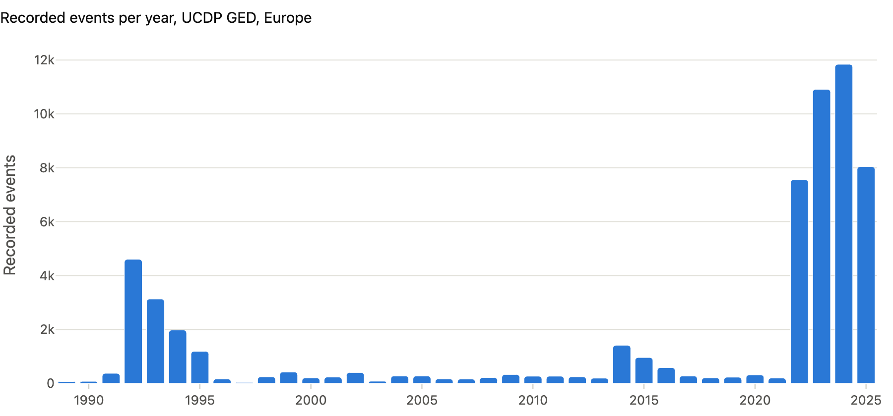
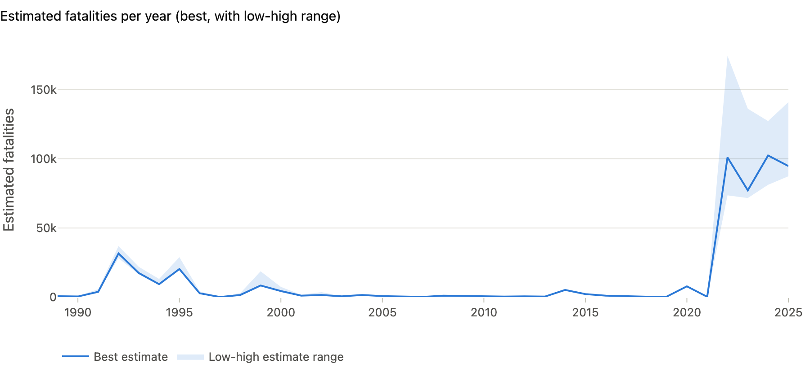
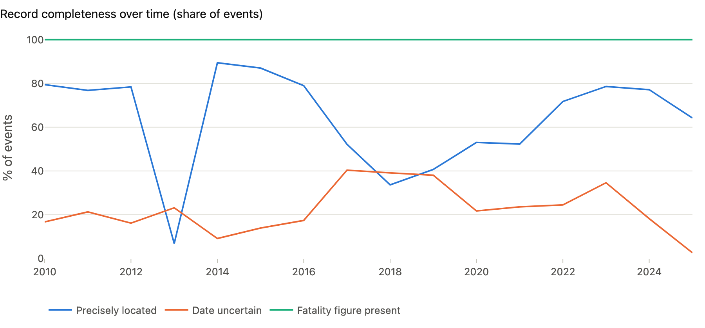
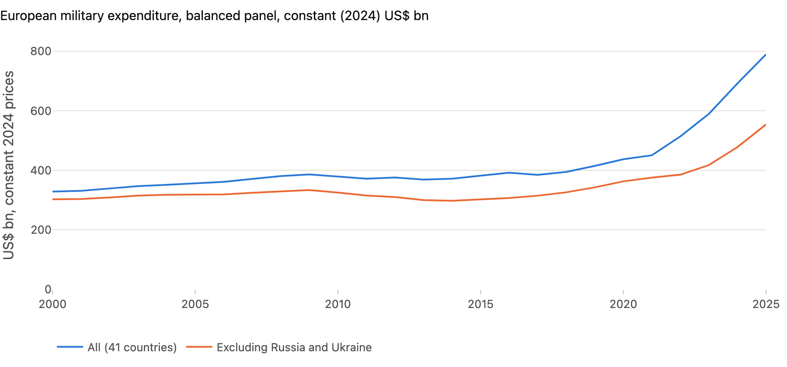
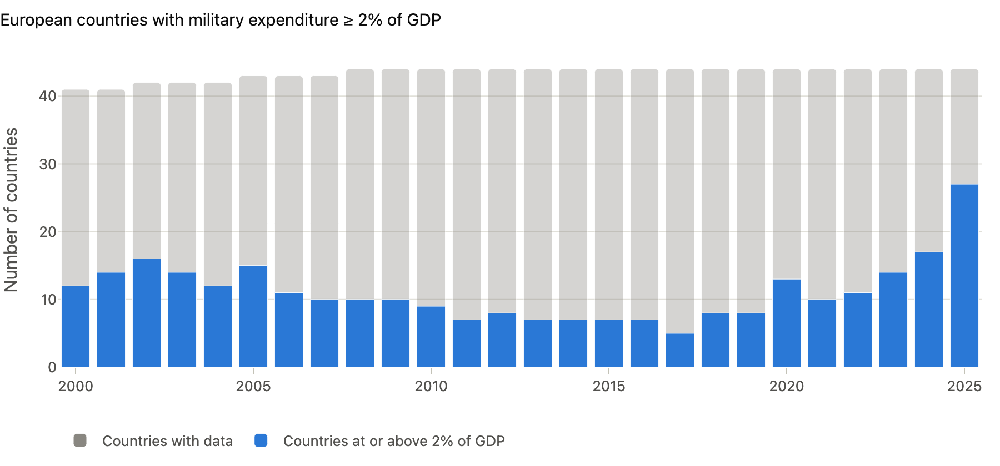
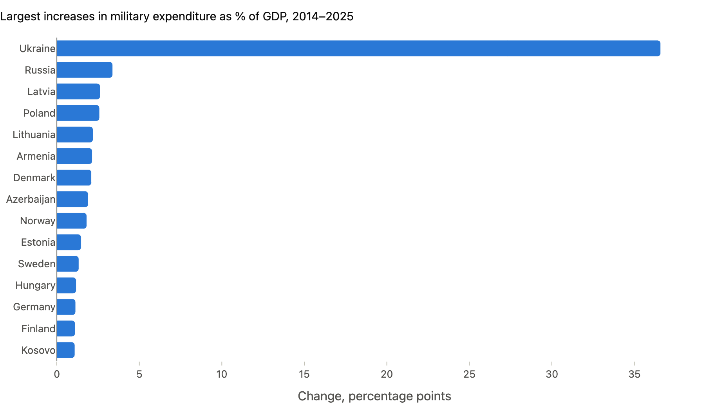

# European Conflict & Security Intelligence: research brief

*Generated 2026-10-17 11:00 UTC by `python -m src.pipeline report`. Every figure in this document is
computed from the processed database; no number is typed by hand.*

## 1. Research questions

1. How has recorded organised violence in Europe changed since 1989, and where is it concentrated?
2. How complete and consistent is the event record, and which apparent trends could be reporting artefacts?
3. How have European military expenditure levels (constant prices) and burdens (% of GDP) changed since 2014?
4. What can, and cannot, be concluded by viewing these two areas side by side?

## 2. Data sources and coverage

| Dataset | Status | Coverage | Retrieved | Licence |
|---|---|---|---|---|
| UCDP Georeferenced Event Dataset (GED) Global v26.1 | real | 1989-01-01 – 2025-12-31 | 2026-10-17 | CC BY 4.0 |
| SIPRI Military Expenditure Database 1949-2025 (v1.2) | real | 1949 – 2025 | 2026-10-17 | SIPRI Terms and Conditions (free non-commercial use with attribution) |

Full provenance (URLs, SHA-256 hashes, transformations) is in the dashboard's *Data quality* page
and in `reports/data_quality/*.json`. Definitions and denominators are in `docs/METHODOLOGY.md`.

## 3. Area A: conflict patterns (UCDP GED)

### A1. Coverage

UCDP GED v26.1 contains **58,016 European events** dated 1989-01-01 to
2025-12-31, in 24 countries (UCDP's historical state coding).
Every event has at least one estimated death, because UCDP includes only conflicts that
cross 25 battle-related deaths in a year. Protests, riots and non-lethal incidents are out of
scope by design.

### A2. Descriptive findings

1. **Two eras dominate the record.** The 1991–1999 wars in the former Yugoslavia peak in
   1992 with 4,601 recorded events; 9,340 of the
   1991–99 events are coded to Bosnia and Herzegovina. From 2022 the Russia–Ukraine war
   produces more recorded events per year than any earlier year in the series:
   7,552 in 2022, 10,911 in 2023,
   11,840 in 2024 and 8,042 in 2025.
2. **Recent European conflict events are almost entirely one conflict.** Of
   38,345 events since 2022, 96.1% are located in Ukraine, and
   98.8% belong to the UCDP conflict "Russia - Ukraine".
   99.2% are state-based conflict events. Any
   Europe-wide aggregate for this period is therefore effectively a Ukraine aggregate.
3. **Events recorded inside Russia rose** from 32 in 2022 to
   734 in 2024 and 537 in 2025. The data record *where* events
   were located. They do not by themselves explain why the location changed.
4. **Fatality estimates are wide.** For 2022 the summed best estimate is
   100,981, within a low–high range of 73,582 to
   174,453. The high estimate is 2.4×
   the low. Point estimates for an active war should not be quoted without this band.
5. **Fatality peaks need not coincide with event peaks.** In 2020, 141 events coded to
   Azerbaijan carry 7,528 estimated deaths
   (97% of Europe's 2020 total), so a small
   number of very lethal events dominates that year.
6. **Spatial concentration.** Since 2022, 65% of precisely located
   events fall in the 10 busiest of 295 occupied 0.5° grid cells
   (roughly 35 × 55 km each). This reflects frontline intensity together with UCDP's practice of
   locating events at the nearest identifiable place.

### A3. Reporting and data-quality signals

- **The latest year is coded differently.** Recorded events fall from 11,840 (2024)
  to 8,042 (2025), but summed best fatalities move from
  102,375 to 94,778. Fatalities per event rise from
  8.6 to 11.8. At the same time, the share of events with an
  uncertain date falls from 18% to
  2.6%, and precisely located events fall from
  77% to 64%.
  Together these point to a change in how events were aggregated or coded, so **the fall in
  2025 event counts should not be read as a fall in violence**. Comparisons across the
  2024/2025 boundary should use fatalities (with ranges) as well as counts, and be re-checked
  against the next UCDP release.
- **Location precision varies by year.** For example, only 7%
  of 2013 events are precisely located, against 89% in 2014.
- **Sources per event** fall from 1.50 (2022) to
  1.11 (2025). Fewer independent reports per event mean
  less corroboration.
- **Historical coding.** 1,177 events (2.0%) fall more than 10 km
  outside the stated country's present-day border. Almost all are 1989–1999 events coded to
  "Serbia (Yugoslavia)" or "Russia (Soviet Union)", plus contested areas. This is a property of the
  coding system, not an error, but it matters for any present-day country filter.

## 4. Area B: European defence trends (SIPRI)

### B1. Coverage

SIPRI's European series cover 41 countries with constant-price data in every year
from 2000 to 2025, the balanced panel used for totals. Values for Russia, Ukraine, Serbia, Luxembourg
in 2025 are SIPRI estimates. Military expenditure follows SIPRI's definition, which is broader than
some national budget lines and differs from NATO's.

### B2. Descriptive findings

1. **Real expenditure has more than doubled since 2014.** The balanced-panel total in constant
   2024 US$ rises by 113% from 2014 to 2025, and by
   75% since 2021. Excluding Russia and Ukraine, whose 2025 figures are
   estimates, the increases are 86% and 48%.
   **The rise is not only driven by the war's two belligerents.**
2. **The latest annual increase is 14.1%** in real terms from 2024
   to 2025 (15.9% excluding Russia and Ukraine). The year before, it
   was 17.4% (14.5%).
3. **More countries spend at least 2% of GDP.** The count goes from 7
   of 44 countries with data in 2014 to
   27 of 44 in 2025.
   The median share rises from 1.25% to
   2.03% of GDP. Because SIPRI's definition differs from NATO's,
   this is not an assessment of NATO commitments.
4. **The largest burden increases are on the eastern flank and among belligerents:** Ukraine (+36.6 pp), Russia (+3.4 pp), Latvia (+2.6 pp), Poland (+2.6 pp), Lithuania (+2.2 pp).
   Ukraine's figure (39.6% of GDP in 2025, an
   estimate) is of a different order and dominates any unweighted average. This is why medians
   are used. 4 of 44 countries record a lower share in 2025 than in 2014.
5. **Levels are concentrated.** In 2025 the five largest spenders (Russia, Germany, United Kingdom, Ukraine, France)
   account for 63% of the European total
   in constant US$.

## 5. Data-quality and reporting limitations

- **Recorded is not occurred.** UCDP relies on reports. Access, media attention and the fog of war
  shape what is recorded, especially in active war zones.
- **Threshold-based inclusion.** UCDP excludes conflicts below 25 battle deaths per year, so low-level
  violence and non-lethal unrest elsewhere in Europe are absent by construction.
- **Latest-year revisions.** Both sources revise back-data. The latest-year coding shift noted in
  A3 is a reason to treat the most recent UCDP year as provisional.
- **Estimates in key cases.** SIPRI figures for Russia and Ukraine are estimates with large uncertainty.
  Wartime budgets are partly secret or off-budget.
- **Definitions.** SIPRI's military expenditure definition is not NATO's. % of GDP depends on GDP
  revisions as well as on spending.

## 6. What can and cannot reasonably be concluded

**Can be concluded (descriptively):** since 2022, European conflict events in UCDP are concentrated
almost entirely in the Russia–Ukraine war. Real military expenditure across Europe rose markedly over
the same period, including outside the two belligerents. The share of countries at or above 2% of
GDP has risen sharply.

**Cannot be concluded:** that rising expenditure was *caused* by the conflict events shown here, or
that it deters them. Both are plausible hypotheses, but they share drivers (threat perception, alliance
decisions, fiscal space), and timing alone cannot separate them. Nor can total casualties or
total violence be inferred from recorded events, or the 2025 drop in event counts be treated as
de-escalation.

## 7. Ideas for further research

1. **Add ACLED for sub-national, non-lethal and threshold-free coverage.** Compare UCDP and ACLED
   counts for Ukraine *as a measurement exercise* (where and why they diverge), not to pool them.
2. **UCDP Candidate Events** (monthly releases) to cover the months after the annual GED cut-off,
   with explicit flags for provisional data.
3. **Event-study design for defence budgets.** Use announced budget decisions, threat-distance
   measures (e.g. distance to the front line) and fiscal controls to test the "proximity" hypothesis
   suggested by the eastern-flank pattern, with pre-trend checks.
4. **Composition of spending.** NATO and EDA data on equipment versus personnel shares to see
   *what* the increases buy.
5. **Uncertainty propagation.** Carry UCDP low/high bands and SIPRI estimate flags into every
   aggregate as intervals rather than point values.
